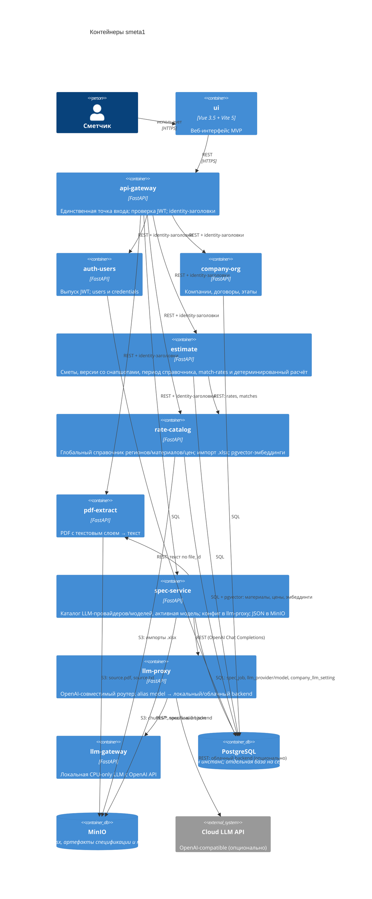

# smeta1 — архитектурный обзор для нового разработчика

> **Architecture update 2026-10-26.** Пересчёт ЕИ (AD-017/AD-018) — целевой скоуп, ещё не реализован; as-built статус — в `sprint-status.yaml`.

Документ для быстрого входа в проект: как устроена система, где живёт код, какие решения уже приняты и почему. Сопровождается архитектурным spine (`docs/architecture-spine.md`), который остаётся источником инвариантов; здесь — человекочитаемая версия.

## 1. Что делает система

smeta1 превращает сметы в PDF (из ГРАНД-Сметы и АВК-Сметы) в структурированный расчёт. PDF извлекается в текст, LLM предлагает черновик структуры спецификации, позиции сопоставляются со справочником расценок по эмбеддингам, а детерминированный сервис считает стоимость. Пользователь (сметчик) работает с компаниями, иерархией договоров, этапами и версиями смет.

**Главная идея:** расчёт никогда не доверяется LLM. LLM только извлекает спецификацию, сопоставление идёт по эмбеддингам; арифметика — фиксированные формулы по сохранённым снапшотам.

## 2. Контекст (C4 Context)

Система работает локально: локальная LLM (CPU-only) обрабатывает данные по умолчанию, внешняя LLM — только при явном согласии и с аудитом.

## 3. Контейнеры (C4 Container)

> Рендер: диаграммы ниже используют Mermaid C4. Если инструмент не отображает их, используйте mermaid.live или локальный плагин; spine содержит эквивалентный `flowchart`.

Наружу экспонируются `ui` (8080) и `api-gateway` (8000). `postgres` и `minio` опубликованы только на `127.0.0.1` для хостовой разработки; остальные сервисы доступны только внутри сети.

## 4. Сервисы и владение

| Сервис | Отвечает за | Путь в дереве |
| --- | --- | --- |
| api-gateway | Маршрутизация, проверка JWT, установка identity-заголовков | `smeta/api-gateway/` |
| auth-users | Пользователи, credentials, выпуск JWT; роли `estimator`/`admin` | `smeta/auth-users/` |
| company-org | Компании, договоры (adjacency list), этапы | `smeta/company-org/` |
| estimate | Сметы, версии (активная ровно одна), позиции со снапшотами, период справочника, `match-rates`, глобальный словарь ЕИ и детерминированный пересчёт, расчёт стоимости | `smeta/estimate/` |
| rate-catalog | Глобальный справочник: регионы, материалы, база 2022, цены по кварталам/зонам, импорт `.xlsx`, pgvector-эмбеддинги и фоновые задачи; источник `material.unit` и цены | `smeta/rate-catalog/` |
| pdf-extract | PDF с текстовым слоем → текст; валидация цифрового PDF | `smeta/pdf-extract/` |
| spec-service | Асинхронная оркестрация по `file_id` (очередь в Postgres): каталог LLM-провайдеров/моделей и активная модель компании, публикация конфига в llm-proxy, текст из pdf-extract, извлечение через llm-proxy, `specification.json` рядом с PDF, INFO-логи этапов | `smeta/spec-service/` |
| llm-proxy | OpenAI-совместимый роутер: alias model → локальный/облачный backend, runtime-конфиг из spec-service, fallback, аудит облака | `smeta/llm-proxy/` |
| llm-gateway | Локальная LLM (CPU-only, GGUF q2–q3), OpenAI API | `smeta/llm-gateway/` |
| ui | Веб-интерфейс MVP (Vue), включая редактор словаря ЕИ | `smeta/ui/` |
| deploy | `docker-compose.yml`, ресурсы, будущий k8s | `smeta/deploy/` |

Каждый сервис — отдельный репозиторий. Общих библиотек нет: связанность только через версионируемые API-контракты.

## 5. Ключевые решения простым языком

Полные формулировки с правилами — в `architecture-spine.md` (блоки AD-xxx); ниже — их смысл.

- **Детерминированный расчёт (AD-001, AD-002).** Позиции хранят снапшоты (`rate_snapshot_id`, `unit_snapshot`, `rate_amount_snapshot`, `qty_catalog_snapshot`, `conversion_factor_snapshot`). Изменение справочника или словаря ЕИ не переписывает старые версии смет; ссылка на каталог нужна только для провенанса.
- **JWT только на входе (AD-010).** Токен выпускает `auth-users`, проверяет **только** `api-gateway`. Внутри сервисы получают личность через заголовки `X-User-Id`, `X-User-Email`, `X-Company-Id`, `X-Role`; gateway обязан затирать эти заголовки из внешнего запроса, чтобы их нельзя было подделать.
- **Правило чистых слоёв (AD-011).** В каждом сервисе код делится на domain → application → infrastructure → transport; зависимости идут только внутрь. Бизнес-логика не знает про FastAPI и SQLAlchemy. Исключение — уже написанный `llm-gateway`.
- **Изоляция по компании (AD-013).** Ключ `company_id` хранится на агрегатных корнях и на дочерних строках, адресуемых напрямую; сервис фильтрует выборки по нему в репозитории. Запрос без компании отклоняется. Исключение — глобальный справочник `rate-catalog` (регионы, материалы, цены, эмбеддинги) без `company_id`.
- **Один Postgres, база на сервис (AD-014).** Один контейнер в compose, отдельная база и свои миграции Alembic у каждого сервиса. Чужие базы не читаем — только API. В образе — `pgvector` для эмбеддингов.
- **Семантическое сопоставление (AD-016).** `rate-catalog` считает E5-эмбеддинги наименований и по cosine выбирает ближайшую цену за точный регион/год/квартал/зону; `estimate` сохраняет `material_id`, `rate_code` и `confidence`. LLM в сопоставлении не участвует.
- **Пересчёт ЕИ (AD-017, AD-018, целевой скоуп).** После привязки `estimate` детерминированно пересчитывает количество в ЕИ справочника. Ручной коэффициент переопределяет словарь; иначе — совпадение ЕИ → словарь/кратность → размеры → упаковка. Неизвестное правило — `conversion_required`, позиция вне расчёта. Словарь `unit_conversion_rule` глобальный (исключение AD-013), редактируется в UI через `estimate`, изменения аудируются; рассчитанные версии заморожены снапшотами.
- **Региональный справочник (AD-008).** Материал уникален в пределах региона; база 2022 (`material_base_price`) и текущие цены (`material_price`) разделены, цены — по кварталам и зонам. Версий справочника нет.
- **Договоры — дерево любой глубины (AD-006, AD-015).** Хранение через `parent_id`; сервис сам не даёт создать цикл или сироту.
- **Приватность извлечения (AD-003).** Внешняя LLM выключена по умолчанию; включение — только с явным согласием и аудитом. Для chat-трафика `llm-proxy` допускается payload без `structure_only` (осознанное исключение, решение 2026-10-22).
- **Владение данными (AD-012).** `auth-users` владеет пользователями, `company-org` — компаниями; регистрация создаёт компанию через API и идемпотентна.

## 6. Как запустить локально

1. `cd smeta/deploy`
2. `cp .env.example .env` и задать `JWT_SECRET` и `LLM_INTERNAL_TOKEN`; при работе с облаком — `cp llm-proxy.env.example llm-proxy.env` и ключи провайдеров.
3. `docker compose up --build`.

Порты: UI — <http://localhost:8080>, api-gateway — <http://localhost:8000>; `postgres` (5432) и `minio` (9001/9000) — только на localhost. Работа с сервисом напрямую (тесты, линт) описана в его `README`; общий стек и smoke-сценарии — `smeta/deploy/README.md`.

## 7. Что уже сделано и что дальше

- **Epic 1–7 (готово):** фундамент, auth/компании/договоры, справочник, PDF→текст, извлечение спецификации и маппинг, версии и расчёт, UI (вход, дерево, загрузка PDF, стадии, экран сметы).
- **После Epic 7 (готово):** Story 7.3–7.5, 7.8, 7.9 (деградация внешних сервисов, целостность PDF, браузерный e2e, шапка пользователя); LLM-настройки (провайдеры/модели, страница `/settings/llm`); региональная база 2022 и цены по кварталам/зонам (Story 3.4–3.5); семантическое сопоставление (Story 8.1).
- **Все истории Epic 1–8 закрыты:** 7.6 и 7.7 подтверждены прогонами 2026-10-25 (7.7 — integration на реальных Postgres/MinIO, `2 passed`).
- **Далее:** пересчёт ЕИ и словарь `unit_conversion_rule` (FR-018/FR-019, AD-017/AD-018) — новый скоуп; UI diff (1.1), калибровка порога 0.70 на реальном корпусе.

## 8. Глоссарий

| Термин | Значение |
| --- | --- |
| Spine | `architecture-spine.md` — короткий набор инвариантов (AD-xxx), которым обязаны следовать все сервисы |
| AD | Architecture Decision: решение с полями Binds / Prevents / Rule |
| Смета | Набор позиций с расценками, привязанный к этапу |
| Версия сметы | Снимок сметы; активна ровно одна |
| Снапшот расценки | Значения расценки на момент расчёта; защищает старые версии |
| ЕИ | Единица измерения |
| Пересчёт ЕИ | Детерминированное преобразование `qty` из ЕИ сметы в ЕИ справочника; результат — `qty_catalog` |
| unit_conversion_rule | Глобальный словарь правил пересчёта ЕИ в `estimate` (алиасы, измерение, коэффициент, кратность, приоритет) |
| conversion_required | Причина, по которой позиция не входит в расчёт: ЕИ не совпадают и правило не найдено |
| confidence | Уверенность сопоставления позиции со справочником, 0–1 (cosine score для эмбеддингов) |
| Регион | Субъект РФ (`region.code`, два знака); материал уникален в пределах региона |
| Ценовая зона | Код зоны в `material_price.zone_code`; цена берётся за точный год/квартал/зону |
| Эмбеддинг | Вектор наименования материала (`material_embedding`, E5-small, 384); используется для поиска цены |
| spec_job | Задача извлечения спецификации в Postgres; очередь и прогресс `spec-service` |
| LLM alias | Имя модели в `llm_model.alias`; `llm-proxy` маршрутизирует по нему на local/cloud backend |
| structure_only | Режим анонимизации: во внешнюю LLM уходят только структуры полей, без значений |
| adjacency list | Хранение дерева через ссылку на родителя (`parent_id`) |
| idempotency key | Ключ, по которому повторный запрос не создаёт второй объект |
