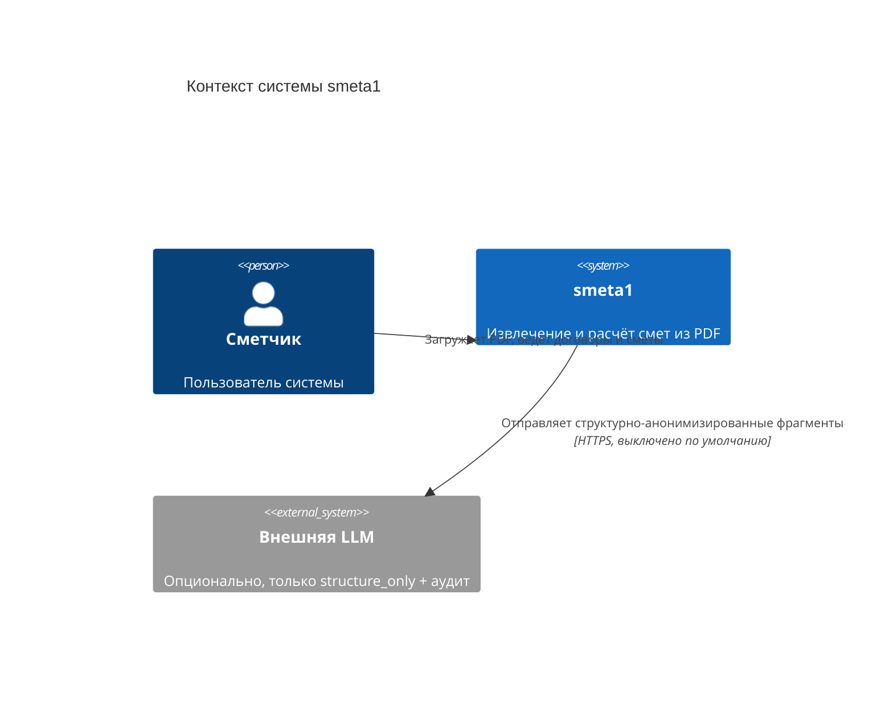
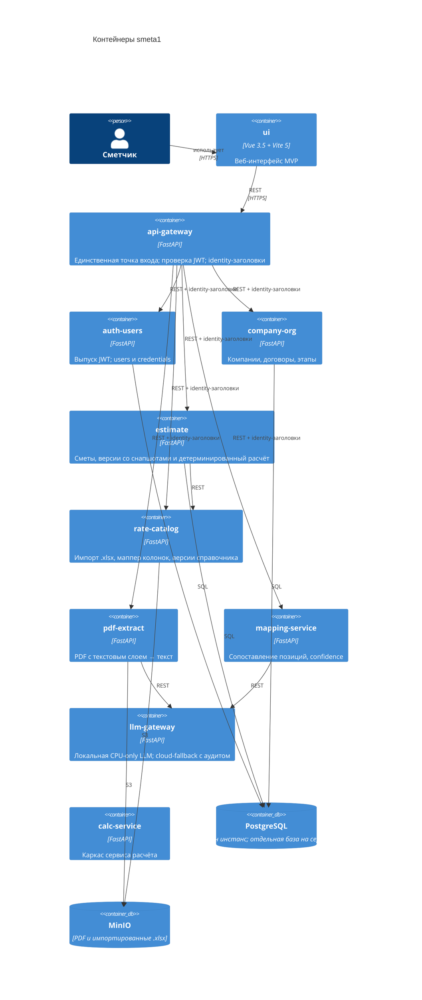

# smeta1 — архитектурный обзор для нового разработчика

Документ для быстрого входа в проект: как устроена система, где живёт код, какие решения уже приняты и почему. Сопровождается архитектурным spine (`ARCHITECTURE-SPINE.md`), который остаётся источником инвариантов; здесь — человекочитаемая версия.

## 1. Что делает система

smeta1 превращает сметы в PDF (из ГРАНД-Сметы и АВК-Сметы) в структурированный расчёт. PDF извлекается в текст, LLM предлагает черновик структуры спецификации, позиции сопоставляются со справочником расценок, а детерминированный сервис считает стоимость. Пользователь (сметчик) работает с компаниями, иерархией договоров, этапами и версиями смет.

**Главная идея:** расчёт никогда не доверяется LLM. LLM только извлекает и сопоставляет; арифметика — фиксированные формулы по сохранённым снапшотам.

## 2. Контекст (C4 Context)

Система работает локально: локальная LLM (CPU-only) обрабатывает данные по умолчанию, внешняя LLM — только при явном согласии и с аудитом.

## 3. Контейнеры (C4 Container)

> Рендер: диаграммы ниже используют Mermaid C4. Если инструмент не отображает их, используйте mermaid.live или локальный плагин; spine содержит эквивалентный `flowchart`.

Наружу экспонируется только `api-gateway`. Остальные сервисы доступны только внутри сети.

## 4. Сервисы и владение

| Сервис | Отвечает за | Путь в дереве |
| --- | --- | --- |
| api-gateway | Маршрутизация, проверка JWT, установка identity-заголовков | `smeta/api-gateway/` |
| auth-users | Пользователи, credentials, выпуск JWT | `smeta/auth-users/` |
| company-org | Компании, договоры (adjacency list), этапы | `smeta/company-org/` |
| estimate | Сметы, версии (активная ровно одна), позиции со снапшотами, детерминированный расчёт стоимости | `smeta/estimate/` |
| rate-catalog | Импорт справочника из `.xlsx`, версии и хранение | `smeta/rate-catalog/` |
| pdf-extract | PDF с текстовым слоем → текст; валидация цифрового PDF | `smeta/pdf-extract/` |
| mapping-service | Сопоставление позиций со справочником, confidence (0–1) | `smeta/mapping-service/` |
| llm-gateway | Локальная LLM (CPU-only, GGUF q2–q3), cloud-fallback + аудит | `smeta/llm-gateway/` |
| calc-service | Каркас сервиса расчёта; детерминированный расчёт выполняет `estimate` | `smeta/calc-service/` |
| ui | Веб-интерфейс MVP (Vue) | `smeta/ui/` |
| deploy | `docker-compose.yml`, ресурсы, будущий k8s | `smeta/deploy/` |

Каждый сервис — отдельный репозиторий. Общих библиотек нет: связанность только через версионируемые API-контракты.

## 5. Ключевые решения простым языком

Полные формулировки с правилами — в `ARCHITECTURE-SPINE.md` (блоки AD-xxx); ниже — их смысл.

- **Детерминированный расчёт (AD-001, AD-002).** Позиции хранят снапшоты (`rate_snapshot_id`, `unit_snapshot`, `rate_amount_snapshot`). Изменение справочника не переписывает старые версии смет; ссылка на каталог нужна только для провенанса.
- **JWT только на входе (AD-010).** Токен выпускает `auth-users`, проверяет **только** `api-gateway`. Внутри сервисы получают личность через заголовки `X-User-Id`, `X-Company-Id`, `X-Role`; gateway обязан затирать эти заголовки из внешнего запроса, чтобы их нельзя было подделать.
- **Правило чистых слоёв (AD-011).** В каждом сервисе код делится на domain → application → infrastructure → transport; зависимости идут только внутрь. Бизнес-логика не знает про FastAPI и SQLAlchemy. Исключение — уже написанный `llm-gateway`.
- **Изоляция по компании (AD-013).** Ключ `company_id` хранится на агрегатных корнях и на дочерних строках, адресуемых напрямую; сервис фильтрует выборки по нему в репозитории. Запрос без компании отклоняется.
- **Один Postgres, база на сервис (AD-014).** Один контейнер в compose, отдельная база и свои миграции Alembic у каждого сервиса. Чужие базы не читаем — только API.
- **Договоры — дерево любой глубины (AD-006, AD-015).** Хранение через `parent_id`; сервис сам не даёт создать цикл или сироту.
- **Приватность извлечения (AD-003).** Внешняя LLM выключена по умолчанию; включение — только с аудитом и структурной анонимизацией.
- **Владение данными (AD-012).** `auth-users` владеет пользователями, `company-org` — компаниями; регистрация создаёт компанию через API и идемпотентна.

## 6. Как запустить локально

1. `cd smeta/deploy`
2. `docker compose up --build`
3. Сегодня в compose описан только `llm-gateway`, и он публикует порт `8000`. По мере появления сервисов наружу должен остаться один порт — у `api-gateway`; остальные переведут на `expose`.

Работа с сервисом напрямую (тесты, линт) описана в его `README`; для `llm-gateway` это `uv run --extra dev pytest -q` и `uv run ruff check .`.

## 7. Что уже сделано и что дальше

- **Epic 1 (готово):** llm-gateway с локальной CPU-only моделью, политика cloud-fallback (structure_only) и аудит.
- **Epic 2 (в работе):** аутентификация и привязка к компании, договоры произвольной глубины, этапы. Именно на этом этапе вводятся AD-010…AD-015.
- **Далее:** справочник расценок (Epic 3), сметы и расчёт (Epic 4–5).

## 8. Глоссарий

| Термин | Значение |
| --- | --- |
| Spine | `ARCHITECTURE-SPINE.md` — короткий набор инвариантов (AD-xxx), которым обязаны следовать все сервисы |
| AD | Architecture Decision: решение с полями Binds / Prevents / Rule |
| Смета | Набор позиций с расценками, привязанный к этапу |
| Версия сметы | Снимок сметы; активна ровно одна |
| Снапшот расценки | Значения расценки на момент расчёта; защищает старые версии |
| ЕИ | Единица измерения |
| confidence | Уверенность сопоставления позиции со справочником, 0–1 |
| structure_only | Режим анонимизации: во внешнюю LLM уходят только структуры полей, без значений |
| adjacency list | Хранение дерева через ссылку на родителя (`parent_id`) |
| idempotency key | Ключ, по которому повторный запрос не создаёт второй объект |
