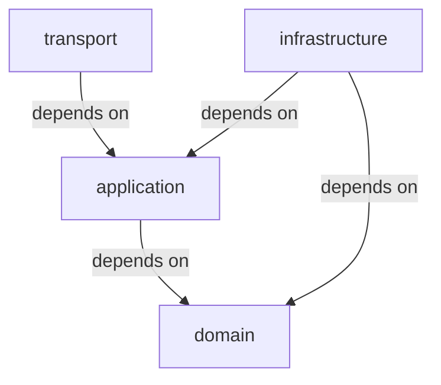
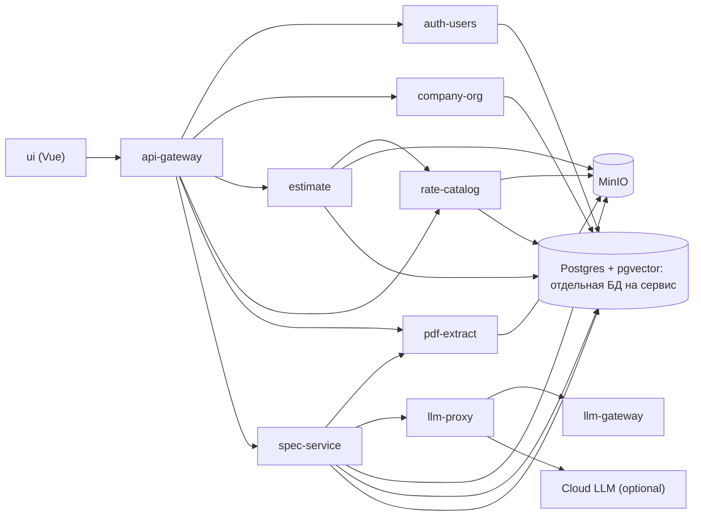

# Architecture Spine: smeta1

## Paradigm
- **Domain-driven boundaries + service-per-capability**. Микросервисы с чёткими границами по домену (org, estimate, catalog, extraction).
- **Determinism first**: расчёт стоимости полностью детерминирован. LLM — только извлечение спецификации, **не** арифметика.
- **Чистая архитектура внутри сервиса** (AD-011): слои domain → application → infrastructure → transport.
- **Направление зависимостей** (правило, а не рекомендация):

## Invariants (Architecture Decisions)

### AD-001: Детерминированный расчёт
- **Binds:** estimate (владелец расчёта), estimate_item (snapshot-значения), валидация сумм
- **Prevents:** утечка LLM-нестабильности в финальную стоимость
- **Rule:** Расчёт выполняет сервис `estimate`: используются только числовые snapshot-поля (`rate_amount_snapshot`, количества) и фиксированные формулы. LLM никогда не выполняет вычисления.

### AD-002: Snapshot расценок
- **Binds:** rate-catalog, estimate, estimate_version, estimate_item
- **Prevents:** пересчёт ранее рассчитанных активных версий смет при изменении справочника
- **Rule:** При расчёте версии сметы сохраняются `rate_snapshot_id`, `unit_snapshot`, `rate_amount_snapshot`. Последующий импорт/изменение цены в `rate-catalog` не влияет на уже рассчитанные версии смет. Поле `rate_catalog_id` — провенанс: по нему при расчёте захватывается снапшот строки расценки; в формулах участвует `rate_amount_snapshot`.

### AD-003: Гибрид LLM с редукцией данных
- **Binds:** llm-gateway, llm-proxy, spec-service, pdf-extract
- **Prevents:** утечка наименований/количеств/ЕИ во внешнюю LLM
- **Rule:** `llm.allow_cloud_fallback = false` (по умолчанию). Для `llm-gateway` `llm.redaction_mode = structure_only`, во внешнюю LLM передаются только структурно-анонимизированные фрагменты. Включение только с явным согласием + аудит. Решение 2026-10-22: облачные маршруты `llm-proxy` разрешены при `LLM_ALLOW_CLOUD_FALLBACK=true` и `X-Allow-Cloud: true` с аудитом, payload без `structure_only` — осознанное исключение для chat-трафика. Каталог провайдеров/моделей и активная модель компании хранятся в `spec_service` (`llm_provider`, `llm_model`, `company_llm_setting`); в БД только имя `api_key_env`, значения ключей — в env `llm-proxy`. Эффективная конфигурация передаётся в `llm-proxy` по внутреннему API (`PUT /internal/config`, startup pull), защищённому `LLM_INTERNAL_TOKEN`. Облачная модель дополнительно требует `LLM_ALLOW_CLOUD=true` в `spec-service`.

### AD-004: CPU-only локальная LLM
- **Binds:** llm-gateway (local runtime)
- **Prevents:** привязка к GPU, выход за 8 ГБ ОЗУ
- **Rule:** Локальный runtime — CPU-only, 8 ГБ ОЗУ. Предпочтение GGUF малых квантов **q2–q3**. Без GPU.

### AD-005: Цифровые PDF без OCR
- **Binds:** pdf-extract
- **Prevents:** избыточная сложность MVP
- **Rule:** Поддерживаются только цифровые PDF с текстовым слоем (источники: **ГРАНД-Смета**, **АВК-Смета**, совместимые). OCR не реализуется в MVP.

### AD-006: Произвольная иерархия договоров
- **Binds:** company-org
- **Prevents:** искусственное ограничение вложенности
- **Rule:** Договоры хранятся в виде **adjacency list** (`parent_id`). Поддерживается **произвольная глубина**. Навигация/отображение — на уровне API/UI без жёсткого фиксированного уровня.

### AD-007: Версионность смет + готовность к diff
- **Binds:** estimate, estimate_version, estimate_item
- **Prevents:** потеря истории правок
- **Rule:** У сметы может быть несколько версий, **ровно одна активная** (`is_active=true`). Структура данных (версия + позиции со снапшотами) готова к вычислению diff. UI diff — **1.1**.

### AD-008: Импорт справочника Excel с маппером колонок
- **Binds:** rate-catalog
- **Prevents:** жёсткая привязка к единому шаблону Excel
- **Rule:** Импорт только из **.xlsx**. Реализуется **маппер колонок** (наименование, ЕИ, цена/расценка и др.). Поддерживаются старый формат КСР и сплит-форма ФСБЦ. Материал уникален в пределах региона; база 2022 хранится в `material_base_price` (1:1 к материалу), текущие цены/индексы — в `material_price` по году, кварталу и ценовой зоне. Версий справочника нет: импорт добавляет/обновляет строки по естественному ключу, а неизменность рассчитанных смет обеспечивает snapshot (AD-002). Справочник **глобальный** (общий для всех компаний), без `company_id`.

### AD-009: Поли-репозиторная топология
- **Binds:** все сервисы (api-gateway, auth-users, company-org, estimate, pdf-extract, llm-gateway, llm-proxy, spec-service, rate-catalog, ui) + deploy
- **Prevents:** спонтанный монорепо-код, скрытое переиспользование кода между сервисами без явного контракта, рассинхрон версий shared-lib
- **Rule:** Каждый сервис — **самодостаточная папка/репозиторий** в дереве `smeta/<service>/`, общий инфраструктурный деплой — отдельной папкой `smeta/deploy/` (docker-compose + k8s). Shared-lib на старте **не вводится**; общие контракты между сервисами — только через API-схемы и сообщения (версионируемые, единый владелец). Git-инициализация и remote — отдельным шагом (локальные папки созданы заранее).

### AD-010: JWT-аутентификация, проверка только на edge [ADOPTED]
- **Binds:** auth-users (выпуск), api-gateway (проверка), все сервисы (потребители identity)
- **Prevents:** разнобой схем аутентификации между сервисами; раздача секрета по всем сервисам; подделка identity при прямом обращении к сервису
- **Rule:** JWT **HS256**, единый HMAC-секрет известен **только** auth-users и api-gateway. Выпускает токены только auth-users. **Подпись проверяет только api-gateway**; к внутренним сервисам снаружи попасть нельзя — из бэкенда экспонируется лишь api-gateway; UI публикуется отдельным фронтенд-контейнером (внутренние сервисы используют `expose`, без `ports`). Claims: `sub` (user_id), `company_id`, `role` (`estimator` для публичной регистрации, `admin` для bootstrap), `iat`, `exp`. TTL access-токена — **168ч (7 дней)**; refresh-токенов нет (повторный логин). Внутрь identity передаётся заголовками `X-User-Id`, `X-Company-Id`, `X-Role`; api-gateway **обязан удалять/перезаписывать** входящие заголовки с этими именами; сервисы токен не парсят и берут identity только из заголовков. Вызовы сервис-ту-сервис пробрасывают те же заголовки.

### AD-011: Чистая архитектура сервисов [ADOPTED]
- **Binds:** все сервисы, **кроме llm-gateway** (исключение)
- **Prevents:** зависимость бизнес-логики от фреймворка и БД; дрейф стилей между сервисами; непокрываемость домена тестами без поднятия инфраструктуры
- **Rule:** Слои внутри сервиса: **domain** (сущности, value objects, порты) → **application** (use cases, оркестрация) → **infrastructure** (адаптеры: БД, HTTP-клиенты, LLM, S3) → **transport** (FastAPI-роуты, схемы запросов/ответов). Зависимости только внутрь (см. диаграмму в Paradigm); `domain`/`application` не импортируют FastAPI, SQLAlchemy и прочие адаптеры; внешние системы доступны только через порты. Исключение: **llm-gateway** написан до этого решения (flat-модуль, 417 строк) — перестраивается при первом крупном изменении или отдельной историей.

### AD-012: Владение user и company [ADOPTED]
- **Binds:** auth-users, company-org
- **Prevents:** два владельца одной сущности; расхождение `user.company_id` и фактической компании
- **Rule:** auth-users владеет `user` и credentials; company-org владеет `company`. Регистрация: auth-users создаёт user → вызывает API company-org (создание company) → сохраняет `company_id`. Распределённой транзакции нет; согласованность через API-вызов и компенсацию при сбое. Вызов создания company **идемпотентен** (idempotency key от auth-users), чтобы ретрай не создал дубль. Прямое чтение/запись чужих сущностей в обход API запрещены.

### AD-013: Tenancy-изоляция по company_id [ADOPTED]
- **Binds:** все сервисы, хранящие доменные данные (company-org, estimate, pdf-extract, spec-service, …)
- **Prevents:** утечка данных между компаниями
- **Rule:** `company_id` хранится на агрегатных корнях (`contract`, `estimate`) и на дочерних строках, адресуемых напрямую (`stage`, `file`, `spec_job`); позиции смет получают scope через владельца-версию сметы. Доступ по id всегда дополнительно проверяет `company_id` владельца. Каждый сервис до бизнес-логики обязан извлечь identity из заголовков (AD-010) и фильтровать все выборки по `company_id` **в репозитории**. Запрос без `company_id` невозможен; отсутствие identity — отказ, а не выборка всех строк.
- **Исключение:** `rate-catalog` — глобальные справочные данные (регионы, материалы, цены, эмбеддинги), `company_id` у них нет. Это осознанное исключение: любой аутентифицированный пользователь может читать и импортировать справочник. `spec-service` хранит глобальные каталоги `llm_provider`/`llm_model`, но выбор активной модели (`company_llm_setting`) и задачи (`spec_job`) — в скоупе компании. Решение 2026-10-25: импорт справочника и управление LLM-настройками доступны всем авторизованным; отдельной серверной проверки роли `admin` для этих операций нет.

### AD-014: Один Postgres, база на сервис, миграции Alembic [ADOPTED]
- **Binds:** все сервисы с БД + deploy
- **Prevents:** столкновение миграций между сервисами; неявные межсервисные join'ы; связывание схем
- **Rule:** Один контейнер PostgreSQL в compose; **отдельная база на сервис**; миграции — **Alembic**, у каждого сервиса свои. Прямые обращения к базе другого сервиса запрещены — только через API.

### AD-015: Запрет циклов и сирот в иерархии договоров [ADOPTED]
- **Binds:** company-org
- **Prevents:** циклы и висячие ссылки в adjacency list, обход которых ломает навигацию и агрегаты
- **Rule:** При insert/move договора сервис поднимается по `parent_id` до корня и отклоняет операцию, если новый родитель — сам узел или его потомок; если `parent_id` указывает на несуществующий узел (orphan) — тоже отказ. Валидация живёт в application-слое company-org и покрыта тестами.

### AD-016: Семантическое сопоставление по эмбеддингам [ADOPTED]
- **Binds:** rate-catalog, estimate
- **Prevents:** ручной перебор расценок и LLM-арифметика при сопоставлении позиций сметы
- **Rule:** `rate-catalog` хранит `material_embedding` (E5-small, 384 измерения, HNSW cosine) и endpoint `POST /v1/rate-catalog/matches`: для каждого наименования считается query-эмбеддинг, выбирается ближайшая **цена** за точный регион/год/квартал/зону. `estimate` сохраняет `rate_catalog_id`, `rate_code` и `confidence` (cosine score 0..1, 4 знака), статус остаётся `proposed`; `needs_review` — по порогу 0.70. LLM в сопоставлении не участвует. Векторы считает фоновый воркер `rate-catalog` (`embedding_job`), доступный по API/UI.

## Services (микросервисные границы)
- **api-gateway** — маршрутизация, **проверка JWT (единственная точка)**, установка/перезапись identity-заголовков, rate-limits при необходимости
- **auth-users** — выпуск JWT, users/credentials, привязка пользователя к компании
- **company-org** — компании, договоры (adjacency list, произвольная глубина), этапы
- **estimate** — сметы, версии (активная ровно одна), позиции (со снапшотами), период справочника, автоматическое сопоставление `match-rates`, **детерминированный расчёт стоимости**
- **pdf-extract** — PDF→текст (pdfplumber/pypdfium2), валидация цифрового PDF, хранение исходника и текста в S3
- **llm-gateway** — OpenAI-совместимый инференс local (CPU-only, GGUF q2–q3); облачная политика `structure_only` + аудит + `allow_cloud_fallback`
- **llm-proxy** — OpenAI-совместимый роутер по alias `model`: локальный llm-gateway или облачный backend, fallback, аудит облачных вызовов, конфиг из spec-service
- **spec-service** — асинхронная оркестрация по `file_id`: очередь задач в Postgres, каталог LLM-провайдеров/моделей и активная модель компании, публикация конфигурации в llm-proxy, текст из pdf-extract, извлечение через llm-proxy, `chunks/*` и `specification.json` в папке PDF, аудит настроек LLM
- **rate-catalog** — глобальный справочник регионов/материалов/цен: импорт Excel (.xlsx), маппер колонок, база 2022, цены по кварталам/зонам, pgvector-эмбеддинги, фоновые задачи
- **s3/minio** — хранение загруженных PDF, импортируемых Excel, артефактов спецификации и GGUF-модели
- **ui (Vue)** — UI MVP: вход, дерево, загрузка PDF, стадии, экран сметы, справочник цен, импорт справочника, настройки LLM (валидация маппинга/diff — 1.1)

## Consistency Conventions

| Concern | Convention |
| --- | --- |
| Naming (сущности, файлы, интерфейсы) | Python: `snake_case` (функции/модули), `PascalCase` (классы); БД и JSON-поля — `snake_case`; REST-пути — существительные во множественном числе; сервисы — `smeta/<service>/`; Vue-компоненты — `PascalCase` |
| Data & formats | Идентификаторы — **UUID**; даты/время — ISO-8601 UTC; ошибки — **RFC 7807 `application/problem+json`**; списки — `limit`/`offset`; денежные суммы — Decimal, не float; версионирование контрактов — в пути (`/v1/...`) |
| State & cross-cutting | Мутации — только через application use cases; логи — структурный JSON с `request_id` и именем сервиса; конфигурация — env-переменные; identity — только из заголовков api-gateway (AD-010); `company_id` обязателен в каждом запросе к домену, кроме глобального `rate-catalog` (AD-013); **внутренняя сеть — граница доверия**: сервисы доверяют identity-заголовкам от api-gateway и недоступны извне |

## Stack

| Name | Version |
| --- | --- |
| Python | >=3.12 |
| FastAPI | 0.146.0 |
| Uvicorn | 0.54.0 |
| Pydantic | 2.14.1 |
| SQLAlchemy | 2.1.5 |
| Alembic | 1.20.0 |
| psycopg | 3.3.6 |
| PyJWT | 2.15.1 |
| PostgreSQL | 18.6 + pgvector 0.8.7 |
| MinIO | RELEASE.2025-10-15T17-29-55Z |
| llama-cpp-python | >=0.3.14 |
| sentence-transformers | >=3.0 |
| Embedding model | intfloat/multilingual-e5-small (384, CPU) |
| Vue | 3.5 |
| Vite | 5.4 (ui/package.json) |
| Node.js | 22 (>=22.20.0; Docker `node:22-alpine`) |
| pytest | >=8 |
| ruff | >=0.6 |
| Docker Compose | v2 |

## Structural Seed

### Контейнеры (упрощённый C4 Container)

Публикация портов: наружу выходят `ui` (`UI_PORT`, по умолчанию 8080) и
`api-gateway` (8000); `postgres` (5432) и `minio` (9000/9001) — только на
`127.0.0.1` для хостовой разработки. Остальные сервисы доступны только во
внутренней сети compose (`expose`).

### Data Model (ключевые сущности)
- **company** (id, name, ...)
- **contract** (id, company_id, parent_id, name, ...) — adjacency list, произвольная глубина
- **stage** (id, company_id, contract_id, name, ...)
- **estimate** (id, company_id, contract_id, stage_id, name, source_file_id?, catalog_region_code?, catalog_year?, catalog_quarter?, catalog_zone?, ...) — привязка к этапу (уровень «подраздел этапа» упразднён 2026-10-20); период справочника nullable и заполняется успешным сопоставлением
- **estimate_version** (id, estimate_id, version_no, is_active, calculated_at, **total_cost**, ...) — ровно одна is_active
- **estimate_item** (id, estimate_version_id, row_ref, manufacturer, name, unit_orig, unit_normalized?, qty, section, rate_catalog_id?, **rate_code**, **rate_snapshot_id**, **unit_snapshot**, **rate_amount_snapshot**, confidence, status, **cost**, ...)
- **region** (code, name) — субъект РФ
- **material** (id, region_code, code, name, unit, group_code?, group_name?) — уникален по `(region_code, code)`; каталог глобальный, без `company_id`
- **material_base_price** (material_id PK, release_price?, base_estimate_price?, imported_at, source_file_hash, created_by?) — региональная база 2022, 1:1 к материалу
- **material_price** (id, material_id, year, quarter, zone_code, rate_amount, current_estimate_price?, index_value?, ...) — текущая цена, уникальна по `(material_id, year, quarter, zone_code)`
- **material_embedding** (material_id PK, embedding vector(384), model_name, model_revision?, source_text_hash, updated_at)
- **embedding_job** (id, status, force, requested_by?, created_at, started_at?, updated_at, finished_at?, ...) — фоновая задача пересчёта векторов
- **file** (id, company_id, storage_key, mime_type, size, meta, created_by?, created_at) и **file_text** (file_id, company_id, page_count, char_count, coverage, extracted_at) — владелец pdf-extract
- **user** (id, company_id, role, ...) — владелец auth-users; **company_id** связывает с company-org
- **spec_job** (file_id PK, company_id, status, phase, total_chunks, processed_chunks, positions_count, attempts, llm_alias?, llm_config?, error_type?, error_detail?, timestamps) — очередь/прогресс извлечения
- **llm_provider** (name PK, display_name, base_url, api_key_env?, timeouts, enabled) и **llm_model** (alias PK, provider_name, proxy_alias, upstream_model?, context_tokens, max_output_tokens, chunk_chars, chars_per_token, prompt_reserve_tokens, response_format, thinking?, cloud, enabled) — глобальные каталоги
- **company_llm_setting** (company_id PK, active_alias, updated_by?, updated_at) — активная модель компании
- **llm_config_audit** (id, user_id?, action, entity_type, entity_name, changes, created_at) — аудит изменений каталога

### Окружения
- **MVP:** локальный `docker-compose` (`smeta/deploy/`); наружу экспонируются **ui** (8080) и **api-gateway** (8000). `postgres` (5432) и `minio` (9000/9001) опубликованы только на `127.0.0.1` для хостовой разработки; остальные сервисы — во внутренней сети (`expose`).
- **k8s:** отложен (см. Deferred).
- Секреты (в т.ч. HMAC-секрет JWT, `LLM_INTERNAL_TOKEN`, ключи провайдеров) передаются через env-переменные compose/`llm-proxy.env`; управление секретами — Deferred.

## Конвейер обработки и шаги UI

1. **Загрузить PDF** → `pdf-extract` → S3/MinIO (валидация цифрового PDF).
2. **Извлечь текст** → `POST /v1/files/{file_id}/extract`; текст сохраняется в
   `{company_id}/{file_id}/source.txt`. Перед шагом удаляются старые результаты
   спецификации (`DELETE /v1/spec/extract/{file_id}/artifacts`).
3. **Извлечь спецификацию** → `spec-service` читает уже извлечённый текст
   (`GET /v1/files/{file_id}/text`), вызывает `llm-proxy` (OpenAI local-first;
   каталог провайдеров/моделей и runtime-конфиг из API) → `llm-gateway/cloud`,
   пишет `chunks/*` и `specification.json`.
4. **Сохранить спецификацию** → `estimate` `POST /v1/estimates/{id}/specification`:
   позиции активной версии заменяются, расчёт сбрасывается.
5. **Сопоставить со справочником** → `UI`/`estimate`
   `POST /v1/estimates/{id}/versions/{vid}/match-rates` с регионом/годом/кварталом/зоной;
   `estimate` вызывает `POST /v1/rate-catalog/matches` (pgvector cosine), сохраняет
   `rate_catalog_id`, `rate_code`, `confidence` только у `proposed`-позиций.
6. **Проверить и рассчитать** → ручная проверка (`confirm`/`correct`) и
   детерминированный `POST .../calculate` в `estimate`.

**Перезапись результатов:** шаг 2 и шаг 3 сначала удаляют старые
`chunks/*`, `specification.json` и job; новые результаты
записываются поверх. Кнопка **Удалить** удаляет смету вместе с версиями и
позициями; если привязан исходный PDF, `estimate` вызывает удаление файла в
`pdf-extract` — запись `file`, все объекты под `{company_id}/{file_id}/` в S3,
job и артефакты. При недоступности pdf-extract смета сохраняется (`502`).

**Инвариант конвейера:** шаг 3 использует `llm-proxy` поверх локального
`llm-gateway`; облачные маршруты — только при явном согласии + аудит
(решение 2026-10-22, без `structure_only`).

## Capability → Architecture Map

| Capability / Area | Lives in | Governed by |
| --- | --- | --- |
| Извлечение PDF → LLM (Epic 1) | pdf-extract, spec-service, llm-proxy, llm-gateway | AD-003, AD-004, AD-005 |
| Аутентификация, компании, иерархия договоров (Epic 2) | api-gateway, auth-users, company-org | AD-010, AD-011, AD-012, AD-013, AD-014, AD-015 |
| Справочник расценок, сметы, расчёт (Epic 3–5) | rate-catalog, estimate | AD-001, AD-002, AD-007, AD-008 |
| Семантическое сопоставление (Story 8.1) | rate-catalog, estimate | AD-016 |
| Настройки LLM (провайдеры/модели) | spec-service, llm-proxy, ui | AD-003 |
| Границы и топология | все сервисы + deploy | AD-009, AD-011, AD-014 |

## NFR-проверяемые цели
- Spec coverage ≥ 95% (цифровые PDF ГРАНД/АВК)
- Price mapping ≥ 90–95%
- Доля позиций с confidence < 0.70 ≤ 15%
- Время обработки 30–60с при локальной CPU-only модели
- Расчёт 100% детерминированный
- Объёмы: 20–50 смет/мес, 100–500 позиций/смета, PDF ≤ 50 МБ
- Локальная LLM CPU-only 8 ГБ RAM, GGUF q2–q3, без GPU

## Deferred (не фиксируем в spine)
- **UI деталей**: валидация маппинга UI, UI diff — **1.1**
- **Refresh-токены и ротация секрета**: при TTL 168ч не нужны; revisit при ужесточении требований безопасности
- **Операционный охват**: k8s-деплой, observability (метрики/трейсинг), backups, управление секретами — revisit перед продовым окружением
- **Схема БД детально** (таблицы, индексы, миграции) — владеют истории эпиков
- **Алгоритм подписи RS256/JWKS**: замена HMAC без изменения контракта токена — revisit при выносе сервисов за доверенную сеть
- **Взаимная аутентификация сервисов (mTLS)**: при TTL 168ч и проверке только на edge доверие опирается на сеть; revisit при выносе сервисов за доверенную сеть
- **Per-company согласие на облако**: `LLM_ALLOW_CLOUD`/`LLM_ALLOW_CLOUD_FALLBACK` сейчас глобальные, а выбор модели — per-company (`company_llm_setting`); tenant-флаг согласия и аудит — при появлении требования
- **Калибровка порога 0.70 и качества эмбеддингов** — после появления реального корпуса PDF/справочника

## Решённые вопросы
- **Очередь конвейера:** отдельный брокер не вводится; очередь — таблица `spec_job` в Postgres (`FOR UPDATE SKIP LOCKED`).
- **Локальная GGUF-модель:** `Llama-3.2-3B-Instruct-Q2_K.gguf`, `LLM_N_CTX=16384`, KV-cache `q4_0`.
- **Публикация host-port llm-gateway:** снята; сервис доступен только через `expose`.
- **Механизм компенсации при регистрации:** реализован в Story 2.1 (идемпотентное создание company).
- **Порядок этапов:** этапы и узлы дерева упорядочены по `created_at`, затем `id` (Story 7.1a).
