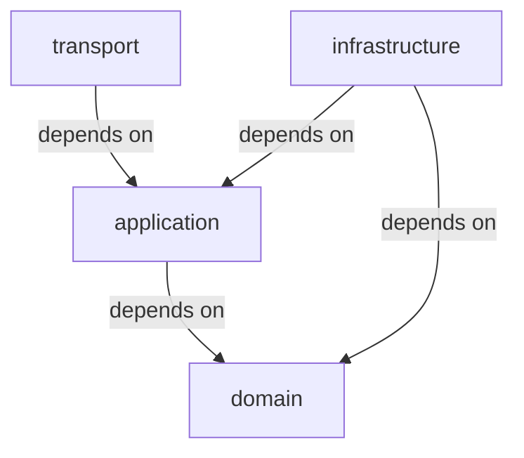
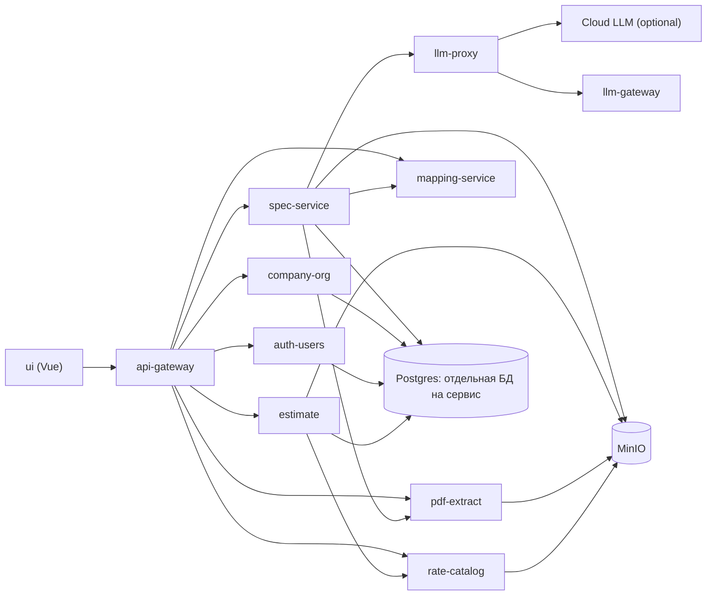

# Architecture Spine: smeta1

## Paradigm
- **Domain-driven boundaries + service-per-capability**. Микросервисы с чёткими границами по домену (org, estimate, catalog, extraction/mapping, calc).
- **Determinism first**: расчёт стоимости полностью детерминирован. LLM — только извлечение/маппинг, **не** арифметика.
- **Чистая архитектура внутри сервиса** (AD-011): слои domain → application → infrastructure → transport.
- **Направление зависимостей** (правило, а не рекомендация):

## Invariants (Architecture Decisions)

### AD-001: Детерминированный расчёт
- **Binds:** estimate (владелец расчёта), estimate_item (snapshot-значения), валидация сумм
- **Prevents:** утечка LLM-нестабильности в финальную стоимость
- **Rule:** Расчёт выполняет сервис `estimate` (решение владельца 2026-10-20): используются только числовые snapshot-поля (`rate_amount_snapshot`, количества) и фиксированные формулы. LLM никогда не выполняет вычисления. `calc-service` остаётся каркасом и расчётом не владеет.

### AD-002: Snapshot расценок
- **Binds:** rate-catalog, estimate, estimate_version, estimate_item
- **Prevents:** пересчёт ранее рассчитанных активных версий смет при изменении справочника
- **Rule:** При расчёте версии сметы сохраняются `rate_snapshot_id`, `unit_snapshot`, `rate_amount_snapshot`. Изменение текущей версии rate_catalog не влияет на уже существующие версии смет. Поле `rate_catalog_id` — провенанс: по нему при первом расчёте захватывается снапшот строки расценки; в формулах участвует `rate_amount_snapshot`.

### AD-003: Гибрид LLM с редукцией данных
- **Binds:** llm-gateway, llm-proxy, spec-service, pdf-extract, mapping-service
- **Prevents:** утечка наименований/количеств/ЕИ во внешнюю LLM
- **Rule:** `llm.allow_cloud_fallback = false` (по умолчанию). Для `llm-gateway` `llm.redaction_mode = structure_only`, во внешнюю LLM передаются только структурно-анонимизированные фрагменты. Включение только с явным согласием + аудит. Решение 2026-10-22: облачные маршруты `llm-proxy` разрешены при `LLM_ALLOW_CLOUD_FALLBACK=true` и `X-Allow-Cloud: true` с аудитом, payload без `structure_only` — осознанное исключение для chat-трафика. Каталог провайдеров/моделей и активная модель компании хранятся в `spec_service` (`llm_provider`, `llm_model`, `company_llm_setting`); в БД только имя `api_key_env`, значения ключей — в env `llm-proxy`. Эффективная конфигурация передаётся в `llm-proxy` по внутреннему API (`PUT /internal/config`, startup pull), защищённому `LLM_INTERNAL_TOKEN`. Облачная модель дополнительно требует `LLM_ALLOW_CLOUD=true` в `spec-service`.

### AD-004: CPU-only локальная LLM
- **Binds:** llm-gateway (local runtime)
- **Prevents:** привязка к GPU, выход за 8 ГБ ОЗУ
- **Rule:** Локальный runtime — CPU-only, 8 ГБ ОЗУ. Предпочтение GGUF малых квантов **q2–q3**. Без GPU.

### AD-005: Цифровые PDF без OCR
- **Binds:** pdf-extract
- **Prevents:** избыточная сложность MVP
- **Rule:** Поддерживаются только цифровые PDF с текстовым слоем (источники: **ГРАНД-Смета**, **АВК-Смета**, совместимые). OCR не реализуется в MVP.

### AD-006: Произвольная иерархия договоров
- **Binds:** company-org
- **Prevents:** искусственное ограничение вложенности
- **Rule:** Договоры хранятся в виде **adjacency list** (`parent_id`). Поддерживается **произвольная глубина**. Навигация/отображение — на уровне API/UI без жёсткого фиксированного уровня.

### AD-007: Версионность смет + готовность к diff
- **Binds:** estimate, estimate_version, estimate_item
- **Prevents:** потеря истории правок
- **Rule:** У сметы может быть несколько версий, **ровно одна активная** (`is_active=true`). Структура данных (версия + позиции со снапшотами) готова к вычислению diff. UI diff — **1.1**.

### AD-008: Импорт справочника Excel с маппером колонок
- **Binds:** rate-catalog
- **Prevents:** жёсткая привязка к единому шаблону Excel
- **Rule:** Импорт только из **.xlsx**. Реализуется **маппер колонок** (наименование, ЕИ, цена/расценка и др.). Каждая успешная загрузка создаёт новую версию справочника.

### AD-009: Поли-репозиторная топология
- **Binds:** все сервисы (api-gateway, auth-users, company-org, estimate, pdf-extract, llm-gateway, llm-proxy, spec-service, mapping-service, rate-catalog, calc-service, ui) + deploy
- **Prevents:** спонтанный монорепо-код, скрытое переиспользование кода между сервисами без явного контракта, рассинхрон версий shared-lib
- **Rule:** Каждый сервис — **самодостаточная папка/репозиторий** в дереве `smeta/<service>/`, общий инфраструктурный деплой — отдельной папкой `smeta/deploy/` (docker-compose + k8s). Shared-lib на старте **не вводится**; общие контракты между сервисами — только через API-схемы и сообщения (версионируемые, единый владелец). Git-инициализация и remote — отдельным шагом (локальные папки созданы заранее).

### AD-010: JWT-аутентификация, проверка только на edge [ADOPTED]
- **Binds:** auth-users (выпуск), api-gateway (проверка), все сервисы (потребители identity)
- **Prevents:** разнобой схем аутентификации между сервисами; раздача секрета по всем сервисам; подделка identity при прямом обращении к сервису
- **Rule:** JWT **HS256**, единый HMAC-секрет известен **только** auth-users и api-gateway. Выпускает токены только auth-users. **Подпись проверяет только api-gateway**; к внутренним сервисам снаружи попасть нельзя — экспонируется лишь api-gateway (внутренние сервисы используют `expose`, без `ports`). Claims: `sub` (user_id), `company_id`, `role` (единая роль MVP), `iat`, `exp`. TTL access-токена — **168ч (7 дней)**; refresh-токенов нет (повторный логин). Внутрь identity передаётся заголовками `X-User-Id`, `X-Company-Id`, `X-Role`; api-gateway **обязан удалять/перезаписывать** входящие заголовки с этими именами; сервисы токен не парсят и берут identity только из заголовков. Вызовы сервис-ту-сервис пробрасывают те же заголовки.

### AD-011: Чистая архитектура сервисов [ADOPTED]
- **Binds:** все сервисы, **кроме llm-gateway** (исключение)
- **Prevents:** зависимость бизнес-логики от фреймворка и БД; дрейф стилей между сервисами; непокрываемость домена тестами без поднятия инфраструктуры
- **Rule:** Слои внутри сервиса: **domain** (сущности, value objects, порты) → **application** (use cases, оркестрация) → **infrastructure** (адаптеры: БД, HTTP-клиенты, LLM, S3) → **transport** (FastAPI-роуты, схемы запросов/ответов). Зависимости только внутрь (см. диаграмму в Paradigm); `domain`/`application` не импортируют FastAPI, SQLAlchemy и прочие адаптеры; внешние системы доступны только через порты. Исключение: **llm-gateway** написан до этого решения (flat-модуль, 417 строк) — перестраивается при первом крупном изменении или отдельной историей.

### AD-012: Владение user и company [ADOPTED]
- **Binds:** auth-users, company-org
- **Prevents:** два владельца одной сущности; расхождение `user.company_id` и фактической компании
- **Rule:** auth-users владеет `user` и credentials; company-org владеет `company`. Регистрация: auth-users создаёт user → вызывает API company-org (создание company) → сохраняет `company_id`. Распределённой транзакции нет; согласованность через API-вызов и компенсацию при сбое. Вызов создания company **идемпотентен** (idempotency key от auth-users), чтобы ретрай не создал дубль. Прямое чтение/запись чужих сущностей в обход API запрещены.

### AD-013: Tenancy-изоляция по company_id [ADOPTED]
- **Binds:** все сервисы, хранящие доменные данные (company-org, estimate, rate-catalog, …)
- **Prevents:** утечка данных между компаниями
- **Rule:** `company_id` хранится на агрегатных корнях (`contract`, `estimate`, `rate_catalog`) и на дочерних строках, адресуемых напрямую (`stage`); позиции смет получают scope через владельца-версию сметы. Доступ по id всегда дополнительно проверяет `company_id` владельца. Каждый сервис до бизнес-логики обязан извлечь identity из заголовков (AD-010) и фильтровать все выборки по `company_id` **в репозитории**. Запрос без `company_id` невозможен; отсутствие identity — отказ, а не выборка всех строк.

### AD-014: Один Postgres, база на сервис, миграции Alembic [ADOPTED]
- **Binds:** все сервисы с БД + deploy
- **Prevents:** столкновение миграций между сервисами; неявные межсервисные join'ы; связывание схем
- **Rule:** Один контейнер PostgreSQL в compose; **отдельная база на сервис**; миграции — **Alembic**, у каждого сервиса свои. Прямые обращения к базе другого сервиса запрещены — только через API.

### AD-015: Запрет циклов и сирот в иерархии договоров [ADOPTED]
- **Binds:** company-org
- **Prevents:** циклы и висячие ссылки в adjacency list, обход которых ломает навигацию и агрегаты
- **Rule:** При insert/move договора сервис поднимается по `parent_id` до корня и отклоняет операцию, если новый родитель — сам узел или его потомок; если `parent_id` указывает на несуществующий узел (orphan) — тоже отказ. Валидация живёт в application-слое company-org и покрыта тестами.

## Services (микросервисные границы)
- **api-gateway** — маршрутизация, **проверка JWT (единственная точка)**, установка/перезапись identity-заголовков, rate-limits при необходимости
- **auth-users** — выпуск JWT, users/credentials, привязка пользователя к компании
- **company-org** — компании, договоры (adjacency list, произвольная глубина), этапы
- **estimate** — сметы, версии (активная ровно одна), позиции (со снапшотами), **детерминированный расчёт стоимости**
- **pdf-extract** — PDF→текст (pdfplumber/pypdfium2), валидация цифрового PDF
- **llm-gateway** — OpenAI-совместимый инференс local (CPU-only, GGUF q2–q3) + cloud (только structure_only + аудит + allow_cloud_fallback)
- **llm-proxy** — OpenAI-совместимый роутер по alias `model`: локальный llm-gateway или облачный backend, fallback, аудит облачных вызовов
- **spec-service** — асинхронная оркестрация по `file_id`: очередь задач в Postgres, каталог LLM-провайдеров/моделей и активная модель компании, публикация конфигурации в llm-proxy, текст из pdf-extract, извлечение через llm-proxy, опциональный маппинг, `specification.json`/`mapping.json` в папке PDF, INFO-логи этапов
- **mapping-service** — сопоставление позиций со справочником, нормализация ЕИ, **confidence** (0–1), пометка <0.70
- **rate-catalog** — импорт Excel (.xlsx), маппер колонок, версии, хранение
- **calc-service** — каркас сервиса расчёта; детерминированный расчёт выполняет `estimate` (решение владельца 2026-10-20)
- **s3/minio** — хранение загруженных PDF и импортируемых Excel
- **ui (Vue)** — простой UI MVP (валидация маппинга/diff — 1.1)

## Consistency Conventions

| Concern | Convention |
| --- | --- |
| Naming (сущности, файлы, интерфейсы) | Python: `snake_case` (функции/модули), `PascalCase` (классы); БД и JSON-поля — `snake_case`; REST-пути — существительные во множественном числе; сервисы — `smeta/<service>/`; Vue-компоненты — `PascalCase` |
| Data & formats | Идентификаторы — **UUID**; даты/время — ISO-8601 UTC; ошибки — **RFC 7807 `application/problem+json`**; списки — `limit`/`offset`; денежные суммы — Decimal, не float; версионирование контрактов — в пути (`/v1/...`) |
| State & cross-cutting | Мутации — только через application use cases; логи — структурный JSON с `request_id` и именем сервиса; конфигурация — env-переменные; identity — только из заголовков api-gateway (AD-010); `company_id` обязателен в каждом запросе к домену (AD-013); **внутренняя сеть — граница доверия**: сервисы доверяют identity-заголовкам от api-gateway и недоступны извне |

## Stack

| Name | Version |
| --- | --- |
| Python | >=3.12 |
| FastAPI | 0.146.0 |
| Uvicorn | 0.54.0 |
| Pydantic | 2.14.1 |
| SQLAlchemy | 2.1.5 |
| Alembic | 1.20.0 |
| psycopg | 3.3.6 |
| PyJWT | 2.15.1 |
| PostgreSQL | 18.6 |
| MinIO | RELEASE.2025-10-15T17-29-55Z |
| llama-cpp-python | >=0.3.14 |
| Vue | 3.5.44 |
| Vite | 5.4 (ui/package.json) |
| Node.js | 24 LTS |
| pytest | >=8 |
| ruff | >=0.6 |
| Docker Compose | v2 |

## Structural Seed

### Контейнеры (упрощённый C4 Container)

### Data Model (ключевые сущности)
- **company** (id, name, ...)
- **contract** (id, company_id, parent_id, name, ...) — adjacency list, произвольная глубина
- **stage** (id, company_id, contract_id, name, ...)
- **estimate** (id, company_id, stage_id, name, ...) — привязка к этапу (уровень «подраздел этапа» упразднён 2026-10-20)
- **estimate_version** (id, estimate_id, version_no, is_active, calculated_at, **total_cost**, ...) — ровно одна is_active
- **estimate_item** (id, estimate_version_id, row_ref, material_work, unit_orig, qty, section, rate_catalog_id?, **rate_snapshot_id**, **unit_snapshot**, **rate_amount_snapshot**, confidence, status, **cost**, ...)
- **rate_catalog** (id, company_id, current_version_id, ...)
- **rate_catalog_version** (id, rate_catalog_id, version, imported_at, source_file_hash, ...)
- **file** (id, storage_key, mime_type, size, meta)
- **user** (id, company_id, role, ...) — владелец auth-users; **company_id** связывает с company-org

### Окружения
- **MVP:** локальный `docker-compose` (`smeta/deploy/`); наружу экспонируется **только api-gateway**, остальные сервисы — во внутренней сети (`expose`).
- **k8s:** отложен (см. Deferred).
- Секреты (в т.ч. HMAC-секрет JWT) передаются через env-переменные compose; управление секретами — Deferred.

## Конвейер обработки и шаги UI

1. **Загрузить PDF** → `pdf-extract` → S3/MinIO (валидация цифрового PDF).
2. **Извлечь текст** → `POST /v1/files/{file_id}/extract`; текст сохраняется в
   `{company_id}/{file_id}/source.txt`. Перед шагом удаляются старые результаты
   спецификации (`DELETE /v1/spec/extract/{file_id}/artifacts`).
3. **Извлечь спецификацию** → `spec-service` читает уже извлечённый текст
   (`GET /v1/files/{file_id}/text`), вызывает `llm-proxy` (OpenAI local-first;
   каталог провайдеров/моделей и runtime-конфиг из API) → `llm-gateway/cloud`,
   пишет `chunks/*` и `specification.json`.
4. `mapping-service` → предложения маппинга с confidence (опционально).
5. `estimate` (детерминированный) → расчёт при валидированных/подтверждённых
   сопоставлениях.

**Перезапись результатов:** шаг 2 и шаг 3 сначала удаляют старые
`chunks/*`, `specification.json`, `mapping.json` и job; новые результаты
записываются поверх. Кнопка **Удалить** удаляет смету вместе с версиями и
позициями; если привязан исходный PDF, `estimate` вызывает удаление файла в
`pdf-extract` — запись `file`, все объекты под `{company_id}/{file_id}/` в S3,
job и артефакты. При недоступности pdf-extract смета сохраняется (`502`).

**Инвариант конвейера:** шаг 3 использует `llm-proxy` поверх локального
`llm-gateway`; облачные маршруты — только при явном согласии + аудит
(решение 2026-10-22, без `structure_only`).

## Capability → Architecture Map

| Capability / Area | Lives in | Governed by |
| --- | --- | --- |
| Извлечение PDF → LLM → маппинг (Epic 1) | pdf-extract, spec-service, llm-proxy, llm-gateway, mapping-service | AD-003, AD-004, AD-005 |
| Аутентификация, компании, иерархия договоров (Epic 2) | api-gateway, auth-users, company-org | AD-010, AD-011, AD-012, AD-013, AD-014, AD-015 |
| Справочник расценок, сметы, расчёт (Epic 3–5) | rate-catalog, estimate | AD-001, AD-002, AD-007, AD-008 |
| Границы и топология | все сервисы + deploy | AD-009, AD-011, AD-014 |

## NFR-проверяемые цели
- Spec coverage ≥ 95% (цифровые PDF ГРАНД/АВК)
- Price mapping ≥ 90–95%
- Доля позиций с confidence < 0.70 ≤ 15%
- Время обработки 30–60с при локальной CPU-only модели
- Расчёт 100% детерминированный
- Объёмы: 20–50 смет/мес, 100–500 позиций/смета, PDF ≤ 50 МБ
- Локальная LLM CPU-only 8 ГБ RAM, GGUF q2–q3, без GPU

## Deferred (не фиксируем в spine)
- **Queue broker**: RabbitMQ/Redis Streams/NATS/Kafka — выбор отложить до архитектурного детализационного шага (зависит от деплоя K8s/local)
- **Точное имя локальной GGUF-модели**: будет подобрано под CPU-only 8 ГБ (q2–q3) при прототипировании
- **UI деталей**: валидация маппинга UI, UI diff — **1.1**
- **llm-gateway: убрать публикацию host-port 8000** в `deploy/docker-compose.yml` — revisit при появлении api-gateway (нарушение edge-only, AD-010)
- **Refresh-токены и ротация секрета**: при TTL 168ч не нужны; revisit при ужесточении требований безопасности
- **Операционный охват**: k8s-деплой, observability (метрики/трейсинг), backups, управление секретами — revisit перед продовым окружением
- **Схема БД детально** (таблицы, индексы, миграции) — владеют истории эпиков
- **Алгоритм подписи RS256/JWKS**: замена HMAC без изменения контракта токена — revisit при выносе сервисов за доверенную сеть
- **Взаимная аутентификация сервисов (mTLS)**: при TTL 168ч и проверке только на edge доверие опирается на сеть; revisit при выносе сервисов за доверенную сеть
- **Порядок этапов и уникальность имён** этапов — решается в story 2.3

## Open Questions (минимум)
- Конкретный брокер очереди? (Deferred)
- Точная локальная модель под 8 ГБ CPU-only? (Deferred)
- Механизм компенсации/ретраев при сбое create company в регистрации (AD-012)? — решается в story 2.1
